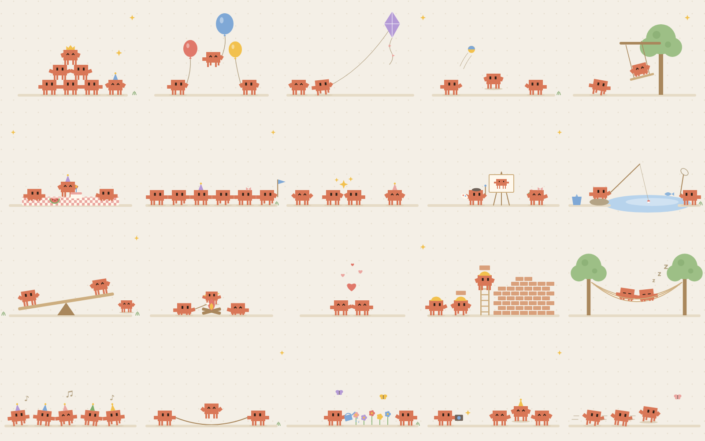

# Tema Clawds

[English](#english) · Español

Tema claro para la app de Claude Code (escritorio y móvil): paleta crema con el naranja de Clawd como acento y un fondo con 64 Clawds pequeños en 20 escenas (pirámide, globos, cometa, pelota, columpio, picnic, desfile, choca esas, pintor, pesca, subibaja, fogata, corazón, construcción, hamaca, conga, cuerda, jardín, foto y persecución). Cada pose se entiende quieta, porque la app de escritorio puede congelar el fondo; si deja animar, también se mueven. En la terminal no se dibuja.



## Instalar

En una terminal con Claude Code abierto:

```
/plugin install clawds --marketplace BEG-lag/tema-clawds
```

Desde la terminal, sin abrir Claude Code:

```bash
claude plugin install clawds --marketplace BEG-lag/tema-clawds
```

En la app de escritorio, donde `/plugin` no funciona: clic en + junto al cuadro de mensaje, luego Plugins, Add marketplace con `BEG-lag/tema-clawds`, y luego Add plugin.

Después de instalarlo, abre una sesión nueva en la app (en modo claro) y mándale cualquier mensaje.

## Archivos

| Archivo | Qué es |
| --- | --- |
| `hooks/register.tsx` | Fija los colores y el fondo al iniciar cada sesión |
| `hooks/scene.ts` | La escena SVG (generada, no se edita a mano) |
| `hooks/make-colors.js` | Generador de paleta del sistema de diseño (no se edita) |
| `scene/build.mjs` | Dibuja la escena; aquí se cambian Clawds, juegos y colores |
| `.claude-plugin/marketplace.json` | Marketplace para instalarlo |

## Cambiar la escena

Desde la carpeta del tema:

```bash
node scene/build.mjs
```

## Actualizar después de un cambio

```bash
claude plugin marketplace update mods-beg && claude plugin update clawds@mods-beg
```

## Notas

- Usar la app en modo claro: la app de escritorio todavía no respeta el modo que pide el tema.
- Clawd es la mascota de Claude Code (Anthropic). Este tema es un proyecto personal, sin relación oficial con Anthropic.

## Licencia

MIT para el código y la escena (ver [LICENSE](LICENSE)). `hooks/make-colors.js` y `hooks/make-colors.d.ts` los genera la herramienta de mods de Claude Code para copiarse tal cual en cada mod; no quedan cubiertos por esta licencia.

## English

A light theme for the Claude Code app (desktop and mobile): a cream palette with Clawd's orange as the accent, and a background where 64 tiny Clawds play in 20 scenes (a pyramid, balloons, a kite, a picnic, a parade, a campfire, a conga line and more). Every pose reads as a still image, because the desktop app may freeze the background; when it lets them animate, they move. Nothing is drawn in the terminal.

Install from a terminal with Claude Code open:

```
/plugin install clawds --marketplace BEG-lag/tema-clawds
```

Or from your shell: `claude plugin install clawds --marketplace BEG-lag/tema-clawds`. In the desktop app, click + next to the message box, then Plugins, Add marketplace with `BEG-lag/tema-clawds`, then Add plugin. Open a new session in light mode afterwards.

The whole scene is generated by `scene/build.mjs` (run `node scene/build.mjs` to redraw it). A personal project, not affiliated with Anthropic.
